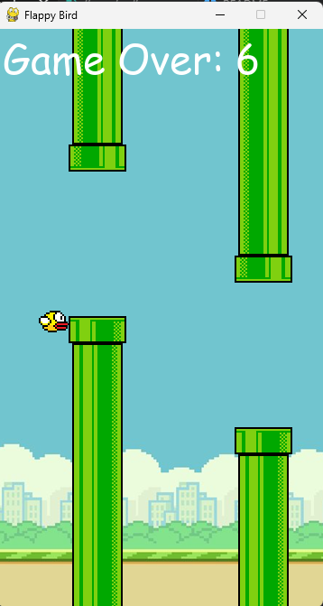

# Flappy Bird




A simple Flappy Bird-style game built in Python using Pygame.

## Overview
This project is a lightweight arcade game where the player controls a bird and tries to fly through gaps in incoming pipes. The goal is to survive as long as possible and score points for each pipe successfully passed.

## Features
- Smooth gravity and flap mechanics
- Procedurally generated pipes
- Collision detection
- Score tracking
- Restart support after game over
- Keyboard controls for gameplay

## Requirements
- Python 3.8 or newer
- Pygame

## Installation
Install the dependency with:

```bash
pip install pygame
```

## How to Run
From the project directory, run:

```bash
python flappybird.py
```

If you're using Windows and `python` is not recognized, try:

```bash
py flappybird.py
```

## Controls
- Space / Up Arrow: flap upward
- Esc: quit the game
- R: restart after losing

## Gameplay
The bird starts in the middle of the screen and falls due to gravity. Press the flap button to push it upward and pass through the gaps between pipes. Each gap passed increases the score. If the bird hits a pipe or the ground/ceiling, the game ends.

## File Structure
- `flappybird.py` — the main game logic, rendering, input handling, and gameplay loop

## Notes
This project is ideal for beginners learning Python game development and Pygame fundamentals such as sprites, events, collision handling, and animations.
